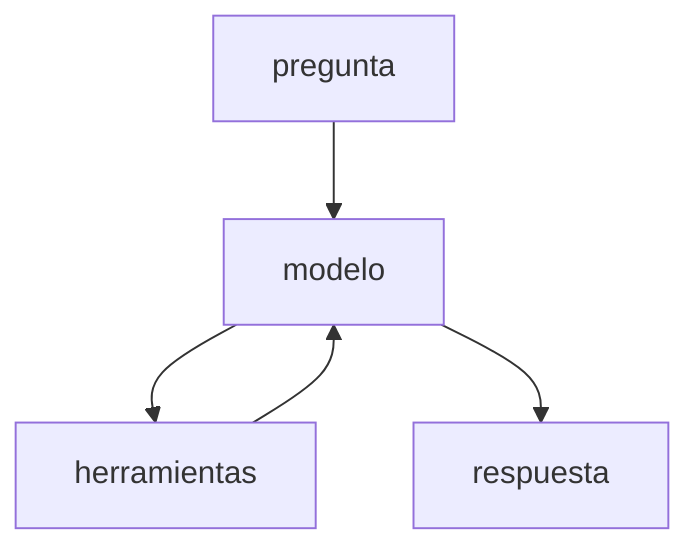

# Arquitectura — [nombre del sistema] (máx. 2 páginas)

Guardalo en tu repo como `docs/arquitectura.md` (en Markdown); al aula virtual va el enlace del repo. Qué pide la
entrega final: la [consigna](https://github.com/JuanFKurucz/ucu-la-project/blob/main/CONSIGNA.md).

## Dominio y problema

Qué pregunta responde el sistema, para quién, con qué documentos (procedencia y licencia).

## Diagrama

Grafo de LangGraph (supervisor, especialistas, aprobación humana), herramientas y base vectorial.
Partí del dibujo que imprime la demo de tu `v05_equipo.py` (práctica M7): solo el dibujo, del primer `---` a la
última línea `classDef`, sin lo que imprime después. Sumale a mano las
herramientas y Chroma, un renglón por flecha, como `investigador --> buscar_web;`,
y probalo en mermaid.live. Para que se vea en este archivo, pegá el texto entre
una línea `` ```mermaid `` y una línea `` ``` ``: GitHub lo dibuja solo. Si en GitHub ves un error en vez del dibujo,
borrá el bloque de configuración (de la primera línea `---` a la segunda): solo elige el estilo de las curvas.
Si tu versión final es el agente solo (v0.4: tu `v10_produccion.py` lo envuelve), dibujá su ciclo en otro
bloque (la primera línea, `graph TD;`, dice qué tipo de dibujo es):



En «Decisiones», decí cuál es tu versión final: el equipo (v0.5) o el agente solo (v0.4).

## Decisiones

| Decisión | Alternativas consideradas | Elegí | Evidencia |
|---|---|---|---|
| *Ejemplo: tamaño de fragmento* | *1000/150 y 400/50 (fragmento/overlap)* | *400/50* | *hit 10/11 → 11/11 con la misma suite* |
| Tamaño de fragmento (chunking) | | | |
| *k* (fragmentos por búsqueda) | *el de partida (4) y el que probaste* | | *el hit con cada `k`, o los tokens por pregunta* |
| Modelo / proveedor | *los dos modelos o sistemas que comparaste en M3* | | *tu tabla de M3: tokens, latencia y respuestas buenas* |
| Herramientas y descripciones | *la descripción o el `SISTEMA` de base y tu cambio (M6)* | | *eligió bien, corrida a contra corrida b* |
| Patrón multiagente | *agente solo (v0.4) o equipo con supervisor (v0.5)* | | *tu tabla de M7: eligió bien, llamadas y latencia de cada uno* |
| Práctica de producción | *trazas, costos, guardrail, caché o evaluación continua (M8)* | | *el extracto de la traza, el costo por mes o tu test, de `evidencia/v1.0.md`* |

## Límites conocidos y próxima prueba

Qué no funciona bien y qué harías con una semana más.
